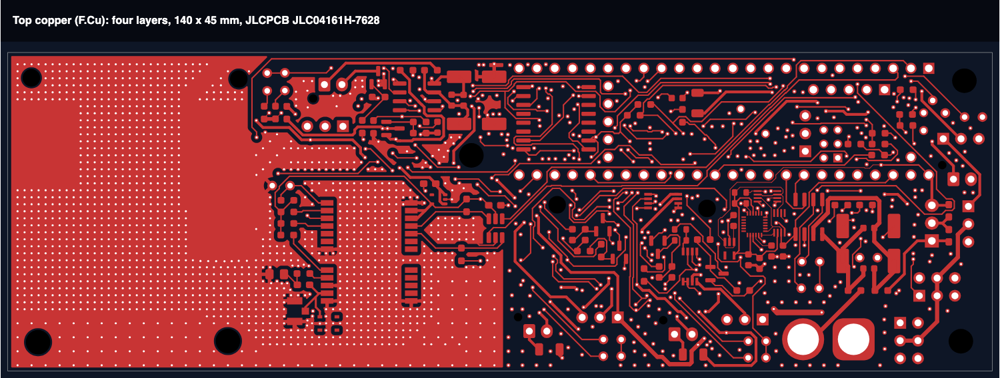
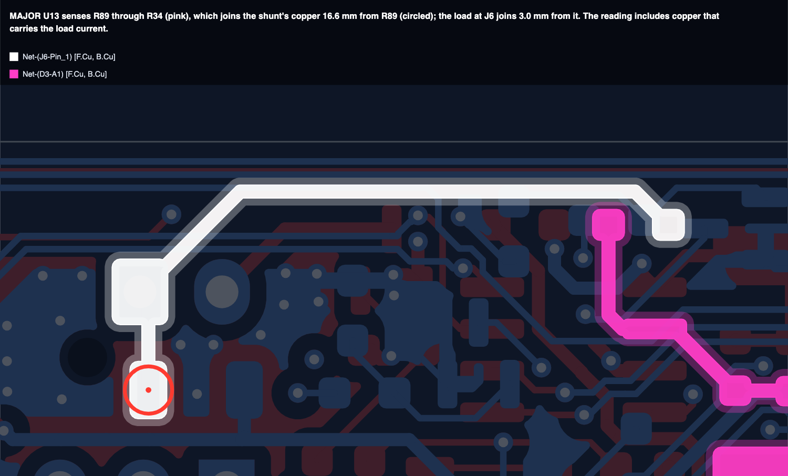
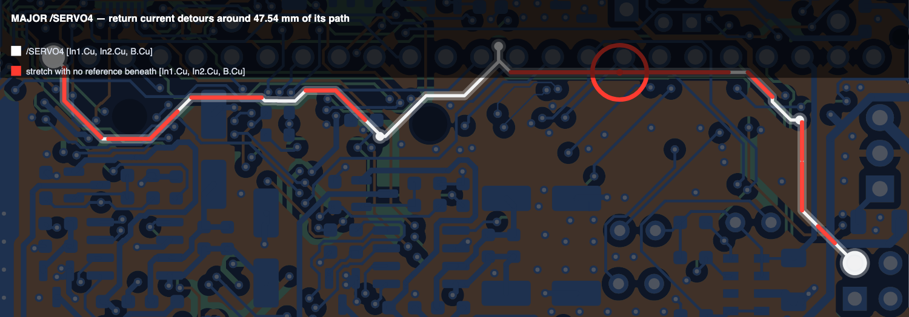
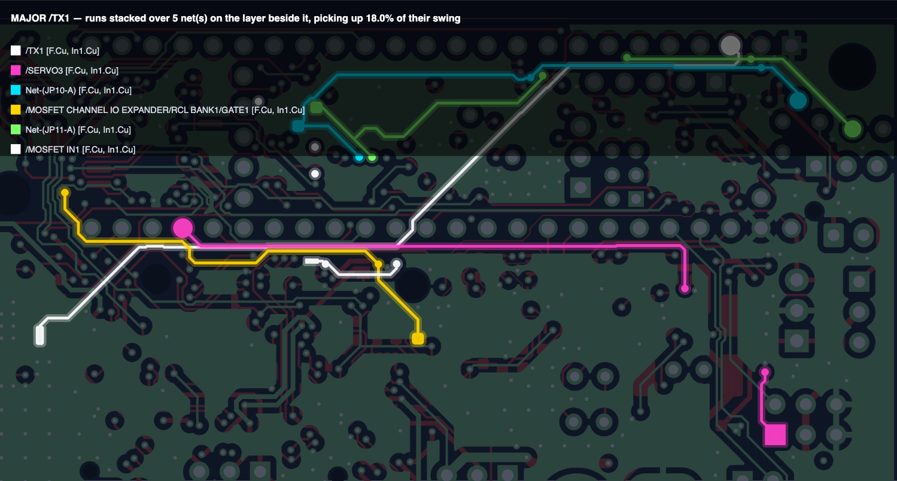
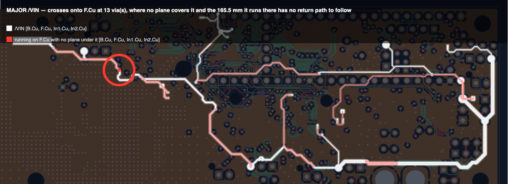
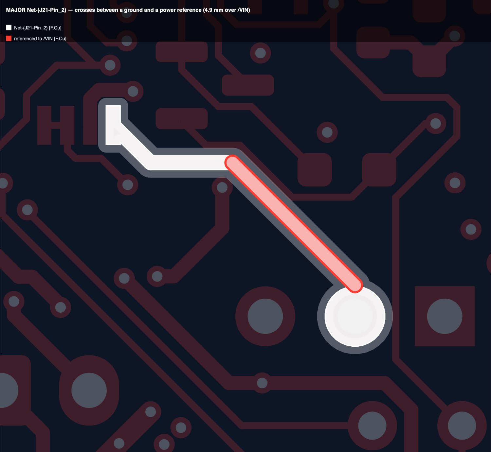

# pcbreview

**A design review of your KiCad board, computed rather than guessed.**

Thirty checks measure your copper — return paths, impedance, crosstalk,
current capacity, junction temperatures, placement, board-versus-schematic
parity — and hand back a ranked list of findings, each carrying the number it
came from, the geometry it was measured on, and what would change its
severity.

You do not run it. **Claude runs it for you** when you ask for a review, and
shows you the handful of things that matter with the offending trace drawn in
a picture. You supply the board, the schematic, which fab stackup you ordered,
and datasheets when it asks for them.



**[See it run](#see-it-run-a-review-of-a-real-board)** ·
**[Install](#download-and-install)** ·
**[Use](#how-to-use-it)** ·
**[How it works](#how-it-works)** ·
**[Why trust it](#why-you-can-trust-it)**

---

## See it run: a review of a real board

This is what a review looks like in Claude Code. The board is real: four
layers, 140 x 45 mm, 210 parts, 195 nets, built on JLCPCB's JLC04161H-7628
stackup. Claude's replies are shortened here, but every number and picture in
them comes from the run. The board's name is left out, as it is from every
file this skill ships.

---

> **You:** Can you review the board in `~/boards/demo/`?

**Claude:** Your board has four copper layers. Before I can measure anything
I need the stackup you ordered from the fab. KiCad's Board Setup won't do: it
is a default that almost nobody edits. One stackup in my library fits a
four-layer board:

- **JLC04161H-7628**: JLCPCB's standard 4-layer, 1.6 mm finished, a 1.065 mm
  core with 7628 prepreg outside it.

Is that the one you ordered? If not, send me a screenshot of your fab's
stackup table and I'll transcribe it.

> **You:** Yes, that one. Here's the impedance table from the order page too.

**Claude:** Bound. Before using it, I checked it against JLCPCB's own
impedance figures:

| JLCPCB's figure | the field solver gets | |
|---|---|---|
| 90 Ω differential pair on L1 | 88.2 Ω | −2.0% |
| 50 Ω single-ended, 14.12 mil on L1 (from your screenshot) | 48.5 Ω | −3.0% |

Both are within the solver's normal margin; it reads about 1.5% low against
JLCPCB.

**One problem straight away: the stackup saved inside your KiCad file is
wrong.** It has every dielectric at 0.01 mm, where the real ones are 0.21 mm
and 1.065 mm, and the inner copper at 35 µm instead of 15 µm. My numbers use
the fab's stackup, so they are unaffected. But every impedance and
length-tuning figure KiCad itself shows you comes from the wrong one. Fixing
it in *Board Setup → Physical Stackup* takes a minute.

Running the review now. It covers the layout and the schematic and takes
about a minute.

---

**Claude:** All 17 layout checks and all 8 schematic checks ran. They found
**97 major findings**, but most of them share a few causes. Here they are by
cause, most important first.

**1. All four current-sense amplifiers measure some of the load's copper.**
U12, U13, U14 and U17 connect their sense inputs to the shunt somewhere other
than the shunt's own pads. On U13, the sense line (pink) joins R89's copper
16.6 mm from the shunt (circled), while the load joins 3 mm from it. So the
reading includes copper that carries the load current. R89 is 20 mΩ, so every
milliohm of that copper is a 5% error. To fix it, run each sense pair straight
from the shunt's pads.



**2. Signal traces on the inner layers break up the ground planes.** Both
inner layers carry a ground pour, but both also carry signal traces through
it. That is the likely common cause of two groups of findings:

- **60 nets have stretches with no plane beneath them** (20 major). On /SERVO4
  that is 47.5 mm of its 78 mm, drawn in red below.
- **51 traces run directly over unrelated traces on the next layer**, 0.21 mm
  apart with no plane in between (24 major). /TX1 picks up 18% of the swing
  of the five nets under it when they switch together.





**3. /VIN runs 165 mm on the top layer with no plane under it at all.** It
crosses onto the top layer at 13 vias, and nothing beneath that copper gives
its return current a path to follow. To rank this I had to assume 1000 ps
edges. If /VIN is plain DC, this matters much less than its severity says.



**4. Same-layer crosstalk: 23 traces pick up noise from their neighbours**
(9 major). The worst is the radio's MISO line, which picks up 11.5% of the
swing of its four neighbours when they switch together.


**5. A net KiCad named for you.** `Net-(J21-Pin_2)` runs over /VIN copper
for 4.9 mm instead of over ground. The name won't mean much, so here it is:



**6. KiCad's own DRC reports 31 violations of 3 rules:** 28 solder-mask
bridges, 2 starved thermal reliefs and 1 courtyard overlap.

**What I could not check, so don't read these as passes:**

- **Temperatures.** I found 30 parts that can dissipate heat but have no
  datasheet for any of them. Send the PDFs for the ones you care about and I
  will read their thermal figures, citing the page each number came from.
- **What the assembler will build.** There is no BOM in the folder.
- **Crystals and decoupling loops.** The placement check found none it could
  measure on this board, so those parts of it did not run. Its other 29
  findings did.

**Questions only you can answer.** Each one changes the severity of findings
above:

1. Is /VIN plain DC, and how much current does it carry?
2. What edge rates do /TX1, /RX1 and the radio's SPI lines run at?
3. What load current flows through each of the four shunts?
4. Were the inner layers meant to carry signals, or meant to be solid ground?

I can also save the full report and these pictures in a `review/` folder
beside the board.

---

You answer in a sentence. Claude writes your answer into a small file beside
the board, so the next review starts from what you said, and re-runs.

---

## Download and install

You need:

| | |
|---|---|
| **Claude Code** | the CLI, the desktop app or an IDE extension. The skill runs on your machine, beside your board files |
| **KiCad 7 or newer** | installed normally. The skill finds KiCad's bundled Python and `kicad-cli` by itself |
| **Python 3.10 or newer** | with `pip`. Validated on 3.13 |
| a Chromium-family browser | optional. Chrome, Edge or Brave turns the pictures into PNG; without one you get SVG |

### Get it from GitHub

The skill must end up in a folder called **`pcbreview`** inside your Claude
skills directory, because that is where it looks for itself. If you already
have an older copy there, move it aside first:

```bash
mv ~/.claude/skills/pcbreview ~/.claude/skills/pcbreview.old
```

**With git (recommended, so you can update with `git pull`).** Copy the
repository URL from the green **Code** button at the top of this page. The
repository is private, so you need access to it, and git will ask you to sign
in (`gh auth login` sets that up once).

```bash
git clone <repository URL> ~/.claude/skills/pcbreview
```

To update later:

```bash
git -C ~/.claude/skills/pcbreview pull
```

**Without git.** Click **Code → Download ZIP**. The archive unpacks to a
folder named after the repository and its branch, so rename it as you move it
into place:

```bash
unzip -q ~/Downloads/Claude-PCBReview-main.zip -d ~/.claude/skills && mv ~/.claude/skills/Claude-PCBReview-main ~/.claude/skills/pcbreview
```

**On Windows**, in PowerShell:

```powershell
git clone <repository URL> "$HOME\.claude\skills\pcbreview"
```

### Then install the dependencies and check the install

On macOS and Linux:

```bash
python3 -m pip install -r ~/.claude/skills/pcbreview/requirements.txt
```

```bash
cd ~/.claude/skills/pcbreview && python3 -m pytest tests/ -q
```

On Windows, in PowerShell:

```powershell
python -m pip install -r "$HOME\.claude\skills\pcbreview\requirements.txt"
```

```powershell
cd "$HOME\.claude\skills\pcbreview"; python -m pytest tests/ -q
```

A correct install prints **`734 passed, 87 skipped`**, or `729 passed, 92
skipped` if you have not installed the optional `pdfplumber`. Those 734 need
no board of yours: they are closed-form physics (analytic limits, IPC-2221,
exact crosstalk identities, a Laplace solve against a rectangle) plus the
tool's own refusals. The skips are opt-in tests that run against a board *you*
register, plus a handful that want `pdfplumber`. Each skip says why in its own
message. See [tests/boards.py](tests/boards.py).

Start a new Claude Code session and the skill is available as `pcbreview`.

**Were you sent `pcbreview-skill.zip` instead?** That is the release archive
built by `packaging/build.py`. [INSTALL.md](INSTALL.md) walks through
installing it step by step on macOS, Linux and Windows, with fixes for the
errors people actually hit. To build one yourself, run
`python3 packaging/build.py`. It refuses to build if anything in the archive
identifies a board or an owner.

---

## How to use it

Ask Claude in your own words, and say where the board is:

> Review my layout in `~/boards/sensor/`.
>
> Is this routed properly? `~/boards/sensor/sensor.kicad_pcb`
>
> Will U3 overheat?
>
> Check the board against the schematic.

Claude asks which fab stackup you ordered, runs the review, and comes back
with the findings grouped by cause, pictures of the copper they name, what it
could not check, and the questions only you can answer. Answer them and it
re-runs. For temperatures it asks for datasheets.

### What you hand over

| | | |
|---|---|---|
| the board | `.kicad_pcb` | required |
| the schematic | `.kicad_sch` | strongly recommended — without it, ground and differential pairs fall back to net-name guesses, and several checks cannot run at all |
| **the stackup** | the fab stackup code you ordered, or a screenshot of your fab's stackup/impedance table | **required.** Nothing else is accepted |
| datasheets | PDFs | for the parts it asks about, after the first run |
| the BOM | `.csv` | optional; compares what the assembler will build against the schematic |

Anything you say about which nets matter — "the firing channels are the ones
to watch" — Claude writes into a manifest so it survives the next run.

### What comes back

Findings ranked by severity, each with the measurement, the derivation, and
what was assumed rather than measured. For anything that names a trace, a
rendered picture of that trace on the board — which matters most for the nets
KiCad auto-named, where "`Net-(C29-Pad2)` has a problem" is useless and a
picture is not.

A full review is usually under a minute on a four-layer board, and a few
minutes on a large dense one; the field solver is 85% of that. It is not hung.

**A second review is 3–5x faster.** Every cross-section the solver computes is
cached on disk and reused — across runs, and across boards built on the same
stackup, so the second board of a project starts warm. The cache holds hashes
and capacitance matrices and no geometry at all, which is why sharing it is
safe.

---

## How it works

KiCad's DRC already tells you what violates a design rule. This is not that,
and it does not reimplement it — where DRC is the right tool, it calls DRC.

What it does instead is **compute the physics**:

- a **2D electrostatic field solver** for the real routed cross-section, not a
  closed-form approximation of it, so an impedance answer accounts for solder
  mask, plane spacing, and the copper actually beside the trace;
- **crosstalk** from that solver's mutual capacitance and inductance, both
  same-layer and broadside — traces stacked on adjacent layers with nothing
  between them, which is the coupling people forget;
- **return paths**, by looking at the copper under the trace layer by layer,
  including what happens at every via;
- **current capacity** by eroding the conductor to find its narrowest real
  channel, and a Laplace solve for a plane's true two-terminal resistance;
- **junction temperatures** from datasheet numbers you supply, plus how far
  your board is from the JEDEC card those numbers assume.

Every conclusion is computed in code — and so is **what gets reported**. Which
findings must appear in a review is a set of rules in `pcbreview/report/`, not
a judgement call, because two sessions given identical inputs once reported
different things. Claude's job is to ask you the questions the run raised,
write down the answers only you have, explain, and draw. It never eyeballs a
coordinate, and it never decides what to leave out.

---

## Why you can trust it

### What it refuses to do

These are deliberate, and they are the reason to trust the rest.

**It refuses to run without a stackup.** Not KiCad's Board Setup — that is a
default nobody edits, and on real boards it has been wrong by more than 2x on
copper thickness and by 95–99% on dielectric heights (the demo above is one of
them). Everything KiCad shows you (length tuning, impedance hints, the 3D
view) is computed from those numbers. So it ships a **library of fab
stackups** — each one a transcription of a table a fab published, with its
provenance recorded — and picking the code you ordered is the whole
conversation. If yours is not in it, you send a screenshot and Claude
transcribes it. Either way the result is then **checked against the fab's own
impedance targets through the field solver** rather than trusted. If a digit
was misread, that check catches it.

**It never reads a thermal number out of a symbol field, and never follows a
datasheet URL found in one.** Measured across 782 symbols in eight real
designs: zero usable thermal fields, and two "datasheet" fields containing a
part number instead of a link. Thermal data comes from a PDF you hand over —
read by pattern-matching the datasheet's own tables first, and by Claude for
whatever those miss — and **every number carries the document and the page it
came from**. Any value Claude offers must also quote the line it read it out
of, and that quote is checked against that page, and against the symbol beside
it, before the value is kept. An unattributed thermal number is
indistinguishable from a guess.

**It does not claim EMC pass or fail.** Nothing here replaces a chamber.

**It does not decide what your nets are for.** It infers buses and rails from
manufacturer pin names, and a net it *cannot* classify keeps full severity —
custom symbols under-name their pins, so silence is not evidence that a net
does not matter. Where your judgement is needed the finding says so and names
the datum it wants. You tell Claude in a sentence, Claude records it, and that
record is the only thing that quietens anything.

**It never writes to your design.** Reading a board does not modify it, and a
test asserts the file's timestamp is unchanged. The only files it adds are
small ones beside the board that record what you told it: the stackup you
chose, your answers about nets, and the datasheet figures it read. Findings
are shown and then gone. If you want them kept, it offers to make a `review/`
folder beside your board — every run's data, yours to read, commit or delete.

### How it is checked

- **734 tests that need no board of yours**: closed-form physics, IPC-2221,
  exact crosstalk identities and a Laplace solve against a rectangle, plus the
  tool's own refusals. Run them yourself; the count to expect is above.
- **[tests/mutation_check.py](tests/mutation_check.py)** breaks the contracts on
  purpose and checks that the tests notice.
- **[tests/validate_all_boards.py](tests/validate_all_boards.py)** re-measures
  every board you point it at against KiCad's own geometry engine. It borrows
  nothing from this code, so it is the strongest check available.
- **Every stackup is checked against the fab's own impedance figures** before
  it is used, as in the demo above: −2.0% and −3.0% against JLCPCB, whose
  calculator this solver is known to read about 1.5% below.
- **Every release is scanned before it is built.** `packaging/build.py` refuses
  to produce an archive that contains a board file or anything that names a
  board, a project or an owner.

### Honesty about coverage

Two checks ship having **never fired on real hardware**: the crystal-loop
placement check (it has still never measured a real oscillator loop — the one board with a crystal used an integrated-load-capacitor resonator, which has its own path now) and the open-drain
pull-up check (across seven designs, exactly one pin was typed open-drain, and
it had its pull-up). Both have synthetic tests. Neither has seen the case it
was written for. Shipping a check that has never seen hardware is defensible;
shipping one silently is not.

More generally: **a zero is not a pass unless the check had something to look
at.** Every check reports what it had to look at, and Claude tells you which
ones had nothing, as it did for crystals and decoupling loops in the demo. One
check went four boards before anyone noticed it was blind.

---

## Going deeper

- [SKILL.md](SKILL.md) — the instructions Claude follows, including every
  command it runs.
- [REFERENCE.md](REFERENCE.md) — how each module works, what it was validated
  against, and where every threshold came from. Read this before changing one.
- [INSTALL.md](INSTALL.md) — installing from the release archive, per platform,
  with troubleshooting.
- [tests/](tests/) — the validation, shipped in full and meant to be run and
  extended.
